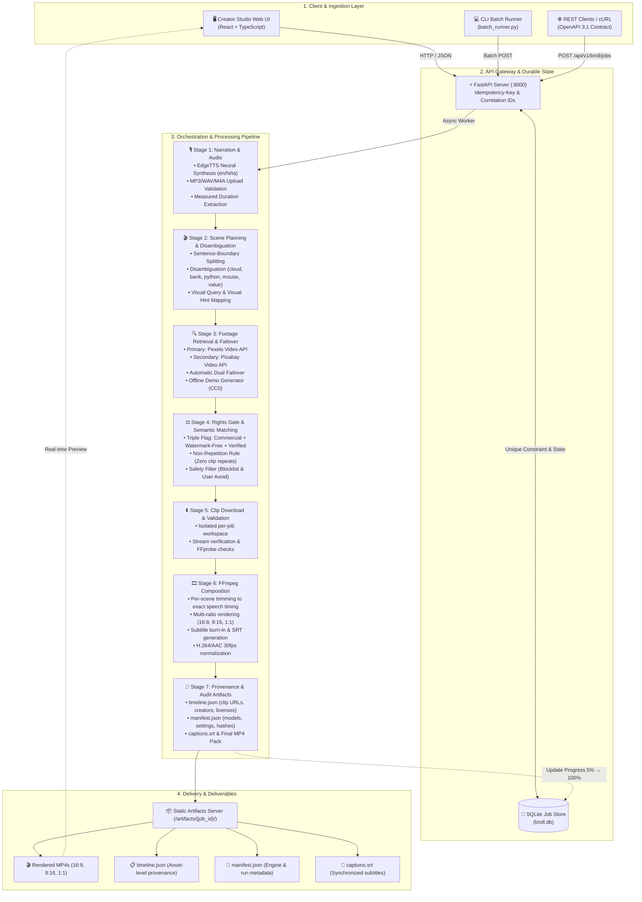

# IncuBrix Script & Voiceover to B-roll Video Engine

An end-to-end, commercial-grade Script and Voiceover to B-roll Video Engine built for the IncuBrix PS3 Engineering Assessment. Converts narration text, audio recordings, or structured scene lists into rights-verified, 1080p-class video compositions across multiple aspect ratios (16:9, 9:16, 1:1) with burned-in subtitles and verifiable provenance audit artifacts.

---

## 🏛️ System Architecture

The IncuBrix B-roll Engine employs a decoupled, safety-first pipeline separating request ingestion, durable state, neural speech synthesis, semantic footage retrieval, rights verification, and multi-ratio FFmpeg composition:



---

## ✨ Features & Capabilities

- **Multi-Mode Ingestion**:
  - **Script Narration**: Raw script text automatically segmented at sentence/phrase boundaries.
  - **Master Voiceover Upload**: Multipart endpoint (`/api/v1/broll/jobs/upload`) supporting MP3, WAV, M4A up to 100 MB and 10 minutes.
  - **IncuBrix Structured Scenes**: Explicit scene arrays with user-provided `visual_hint` overrides.
- **Commercial Footage Retrieval with Failover**:
  - Primary provider: **Pexels Video API** (`FOOTAGE_PROVIDER=pexels`).
  - Secondary provider: **Pixabay Video API** (`FOOTAGE_PROVIDER=pixabay`).
  - Dual failover adapter: `MultiSourceFootageProvider` switches sources seamlessly upon provider errors or rate limits.
  - Offline testing: Deterministic `MockFootageProvider` ensures all tests pass without network or API keys.
- **Intelligent Scene Planning & Disambiguation**:
  - Context-aware disambiguation for ambiguous words (`cloud`, `bank`, `python`, `mouse`, `value`).
  - Automatic detection of sensitive topics (violence, war, accidents) with cautionary warnings.
  - User-configurable `avoid` keyword list and strict content safety filtering.
- **Commercial Rights & Provenance Verification**:
  - Triple eligibility gate: every asset must be verified for commercial use, watermark-free, and rights-verified.
  - Zero clip repetition across each output video.
  - Generates verifiable `timeline.json` (per-scene asset URL, licence, creator, timestamp, decision rationale) and `manifest.json`.
- **1080p-Class FFmpeg Composition**:
  - Outputs rendered in requested aspect ratios: **16:9** (1920x1080), **9:16** (1080x1920), and **1:1** (1080x1080).
  - Normalised H.264/AAC, 30 fps, YUV420p pixel format validated with FFprobe.
  - Configurable burned-in subtitles and standalone `captions.srt` file generation.
- **Modern Creator Studio UI**:
  - Dark mode glassmorphism React + TypeScript client.
  - Tabbed input modes, multi-ratio pill selectors, neural voice selector, live progress polling (0–100%), video player preview, and direct download links for all deliverables.

---

## 🚀 Quick Start

### Prerequisites
- Python 3.11+
- Node.js 18+
- FFmpeg & FFprobe (in system `PATH`)

### 1. Backend Setup

```bash
# Copy environment configuration
cp .env.example .env

# Create and activate virtual environment
python -m venv .venv
source .venv/bin/activate  # On Windows: .\.venv\Scripts\activate

# Install dependencies
pip install -r requirements.txt
pip install -r requirements-dev.txt

# Start FastAPI server
uvicorn app.main:app --reload --port 8000
```
API Documentation will be live at `http://localhost:8000/docs` (OpenAPI spec: `http://localhost:8000/api/v1/openapi.json` or `openapi.yaml`).

### 2. Frontend Setup

```bash
cd frontend
npm install
npm run dev
```
Creator Studio UI will be live at `http://localhost:3000`.

### 3. Run with Docker Compose

```bash
docker compose up --build
```

---

## 🧪 Automated Testing

Run the complete test suite (41 unit and integration tests) without requiring any API keys:

```bash
pytest tests/ -v
```

### Test Coverage Highlights:
- `tests/test_api.py`: Idempotency keys, validation, 404s, correlation IDs, multipart file upload limits.
- `tests/test_planner.py`: Boundary splitting, context disambiguation (cloud vs cloud computing, python snake vs language), visual hints.
- `tests/test_audio.py`: EdgeTTS adapter, mock timing, duration bounds, corrupt audio rejection.
- `tests/test_footage.py`: Eligibility gates, mock isolation, multi-source failover, safety blocklists.
- `tests/test_matching.py`: Semantic scoring, non-repetition constraint, rights enforcement.
- `tests/test_pipeline.py`: End-to-end pipeline execution, job state store transitions, error handling.
- `tests/test_renderer.py`: FFmpeg ratio dimensions, stream codecs, 1080p class compliance.
- `tests/test_artifacts.py`: Provenance audit records, timeline.json and manifest.json schemas.

---

## 📦 Batch Runner

Process a single fixture or an entire directory of test inputs, polling each to completion and saving all resulting media and audit artifacts:

```bash
python cli/batch_runner.py fixtures output/ --base-url http://localhost:8000
```

10 comprehensive Core test fixtures are provided in `fixtures/`:
1. `01_tech_tutorial.json`: Cloud computing (ambiguous "cloud").
2. `02_finance_news.json`: Financial banking (ambiguous "bank", "value").
3. `03_product_promo.json`: Short punchy copy for 1:1 social promo.
4. `04_story_narrative.json`: Cinematic narrative storytelling.
5. `05_python_tutorial.json`: Coding tutorial (disambiguated "Python" vs snake).
6. `06_mouse_review.json`: Computer hardware (disambiguated "mouse" vs animal).
7. `07_startup_stats.json`: Abstract statistics and business concepts.
8. `08_wellness_vertical.json`: Lifestyle and meditation for 9:16 vertical format.
9. `09_green_energy_scenes.json`: IncuBrix structured scene list with `visual_hint`.
10. `10_cooking_all_ratios.json`: Food video testing simultaneous 16:9, 9:16, and 1:1 generation.

---

## 🛡️ Provenance & Rights Policy

All media handled by the IncuBrix engine adheres strictly to commercial-use verification standards:
- **No public asset is presumed commercially eligible** without verified licensing.
- Mock assets (`mock://...`) are permanently flagged as `commercial_use: false` and are prohibited from rendering in production.
- Every selected clip captures: provider, source URL, license identifier, terms URL, creator, attribution, commercial flag, watermark status, AI-generated flag, and retrieval timestamp.
- Detailed provider documentation and terms checks are recorded in `SOURCES.md`.
